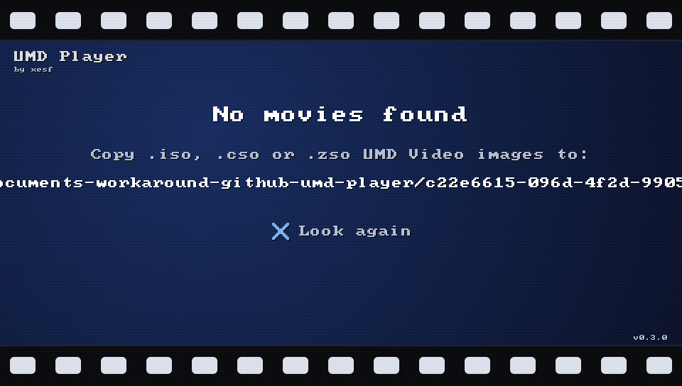
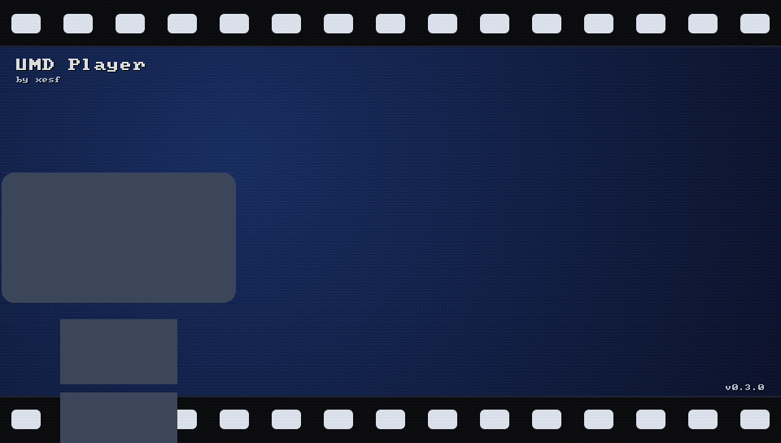
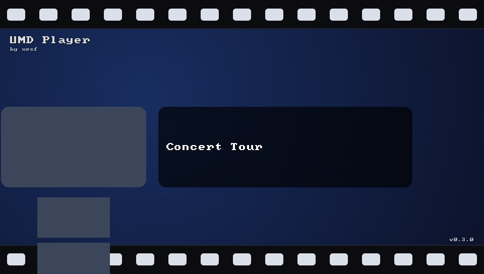
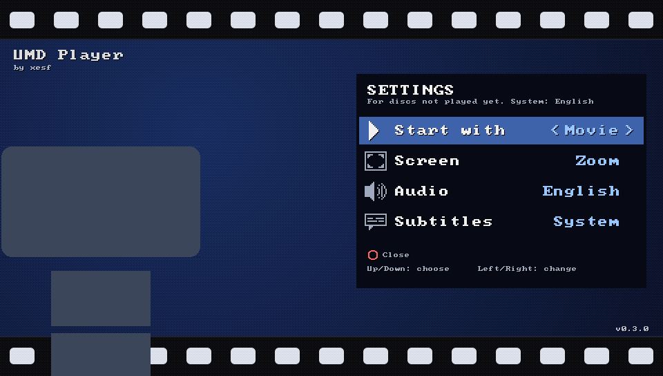
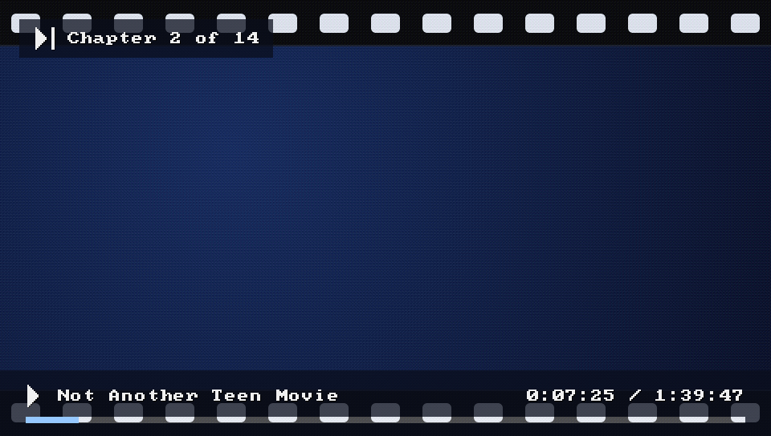
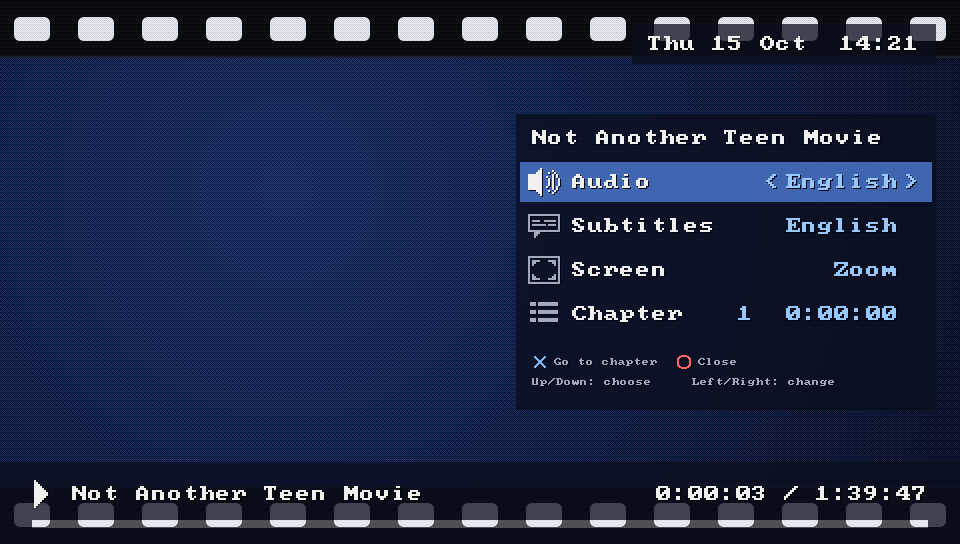

# UMD Player manual

UMD Player plays UMD Video discs on the PS Vita from disc images: the movies, TV episodes and concerts that Sony sold on UMD for the PSP. It plays them natively, without Adrenaline or the PSP firmware, and it can run a disc's own menus as a PSP does.

The screenshots show the app's own screens with placeholder discs. With your discs, the library shows each disc's background art and animated icon.

## Install

1. Copy `umdplayer-v<version>.vpk` to the memory card, for example with VitaShell's USB connection.
2. In VitaShell, open the file and install it.
3. In the HENkaku settings, turn on "Enable unsafe homebrew". Adrenaline needs this setting too, so it is probably on already.

UMD Player appears on the home screen with a UMD caddy icon. Its LiveArea has a Manual button with a short version of this guide (drawn by `tools/make_manual.py`).

## Add your movies

Copy disc images to either folder on the memory card:

- `ux0:umd/`
- `ux0:pspemu/ISO/VIDEO/` (the folder Adrenaline users already have)

UMD Player reads `.iso`, `.cso` and `.zso` files, also in subfolders up to three levels deep, so you can sort movies by genre or country (`ux0:umd/Action/`). A file in two places shows once.

You need a dump of a UMD Video disc. A PSP with custom firmware can dump a UMD over USB. Only UMD Video discs play; PSP game discs do not.

With no movies, the library says where to copy them. Press ✕ to look again after copying.

## The library

The selected disc is the large icon on the left. On a PSP-authored disc, the background, the animated icon and the music come from the disc. The other discs are listed under and above it.

| Button | What it does |
|---|---|
| Up, Down | Choose a disc |
| ✕ | Play the disc (from where you left it, if you watched it before) |
| □ | Play the disc from the start, keeping its settings. With disc menus, the disc starts as if inserted for the first time. |
| Select | Show or hide the disc's name and resume point |
| △ | Open the settings |
| Start (F1 on a computer) | Open this manual. Left and Right turn the pages; ○ closes it. |
| Touch | Drag up or down to move through the discs. Tap a disc above or below to select it, and the selected disc to play it. |
| PS button | Leave the app |

Select shows a panel with the disc's name. For a disc you have watched, it also shows where you stopped and how much of the movie that is.

## Settings

Press △ in the library. Use Up and Down to choose a row, Left and Right to change it, and ○ or △ to close. The settings are saved when the panel closes.

| Setting | Values | What it does |
|---|---|---|
| Start with | Disc, Movie | Disc (the default) plays the disc as a PSP would: logos, warnings, the disc's menus, then the movie. Movie plays the movie at once. |
| Screen | Fit, Zoom, Fill, Stretch | The picture size for discs you have not played yet. |
| Audio | 16 languages | The audio language for new discs. A disc without it plays its first track. |
| Subtitles | Off, System, 16 languages | The subtitle language for new discs. System uses the Vita's language. |

A disc you have watched keeps its own audio, subtitle and screen choices.

## Watching a movie

| Button | What it does |
|---|---|
| ✕ or Start | Pause or play |
| Left, Right | Back or forward 10 seconds. Hold to rewind or fast-forward; the longer you hold, the faster it goes. |
| Up, Down | Next or previous chapter |
| L, R | Previous or next title on the disc (episodes, extras) |
| □ | Next screen mode |
| △ | Open the options panel |
| Select | Show the time bar |
| ○ | Back to the library |

The touch screen also works: tap to show or hide the time bar, and while it shows, slide along it and lift your finger to jump there.

The time bar shows the disc's name, the position and the length. It appears when you change chapter, press Select, or tap the screen.

The options panel (△) changes the audio and subtitle tracks while the movie plays, the screen mode, and the chapter. It also shows the date, time and battery. Use Up and Down to choose a row and Left and Right to change it. On the chapter row, ✕ jumps to the chosen chapter. ○ or △ closes the panel.

### Screen modes

- **Fit**: the whole picture at its shape, with black bars where needed.
- **Zoom** (the default): finds black bars inside the picture and fills the screen with what is inside, cropping at most 10%.
- **Fill**: fills the screen and crops what does not fit.
- **Stretch**: fills the screen and ignores the shape.

## Disc menus

With "Start with: Disc", UMD Player runs the disc's own menus: the menu screens, their animations, and the choices of audio, subtitles, chapters and extras they offer. A disc without menus plays its short intro titles, such as logos and warnings, and then the movie.

| Button | In the disc's menus | During the movie |
|---|---|---|
| D-pad | Move between menu items | As in "Watching a movie" |
| ✕ | Choose the item | Pause or play |
| ○ | Back, as the disc defines it | Open the disc's menu |
| △ | On a list shown over the movie, the disc's menu (the PSP's menu button). Elsewhere in the menus, nothing. | Options panel |
| L, R | | Previous or next chapter |
| Select | Back to the library | Back to the library |
| Touch | Tap an item to choose it. Swipe to move, as with the D-pad. | As in "Watching a movie" |

Some discs move their highlight themselves and have no items to tap. On those, swipe to the item, then tap anywhere to choose it.

During the movie, ○ goes to the disc's main menu. Some discs answer the PSP's menu button with a list over the movie, such as Saw's scene list; UMD Player then presses it again, so ○ always ends at the main menu.

Holding ○ for 1.5 seconds also goes back to the library.

When you leave a disc, it saves its own place, as on a PSP. The next time, the disc continues from there. Some discs ask first. In the library, the Select panel says "Continue where you left off", and □ starts the disc from the beginning instead.

## Interactive movies (UMD-PG)

UMD-PG discs are interactive movies. The story stops at choices, and what you choose decides what plays next. Summer Days is one. In the library, the Select panel marks these discs "Interactive movie (UMD-PG)". UMD Player always plays them through their own menus, whatever "Start with" says.

| Button | What it does |
|---|---|
| D-pad | Move between the choices in a choice window, or between the digits of a password |
| ✕ | Choose. During the story: pause or play. |
| ○ | During the story: show the password for this point of the story |
| Select | Back to the library. The disc continues from here next time. |

### Passwords

A game on several discs, such as Summer Days, carries your progress from one disc to the next with a 4-digit password. A password also takes you back to a point you reached before.

1. During the story, press ○. The game shows the password for the point you have reached, and the disc that it is for. Write both down.
2. To hide the password, pause the story with ✕, then press ✕ again to play.
3. Start the disc that the password is for. In its title menu, choose the option that loads a game. On discs 2 and 3 of Summer Days, the start option itself asks for the password.
4. Enter the password: Up and Down change a digit, Left and Right move to another digit. Then choose OK (決定) with ✕. Back (戻る) returns to the title menu.

The story continues from the point that the password stands for. You do not need a password to continue the same disc: leaving the disc keeps your place.

## What UMD Player remembers

- Where you stopped each disc, and its audio, subtitle and screen settings: `ux0:data/umdplayer/resume.txt`.
- Where you left each disc played through its menus, with the disc's own saved data: `ux0:data/umdplayer/discs.txt`.
- Your settings: `ux0:data/umdplayer/settings.txt`.

Deleting a file resets what it holds.

## Troubleshooting

| Problem | What to do |
|---|---|
| The library is empty | Check that the files are in `ux0:umd/` or `ux0:pspemu/ISO/VIDEO/` and end in `.iso`, `.cso` or `.zso`. Press ✕ to look again. |
| Movies in `ux0:pspemu` are missing | Turn on "Enable unsafe homebrew" in the HENkaku settings. |
| The LiveArea still shows an old version after an update | Delete the app and install the new VPK again. |
| A movie freezes or stutters | Send `ux0:data/umdplayer/log.txt` with the bug report. Its `stall:` lines show what stopped. |
| A disc's menus misbehave | Use "Start with: Movie" for that disc, and report the disc and what you did. |
